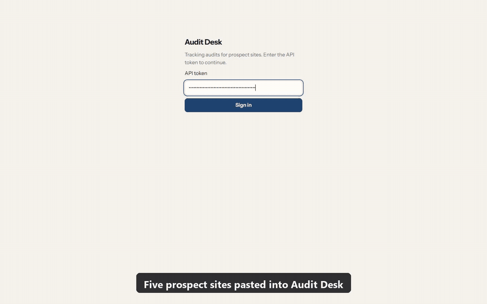
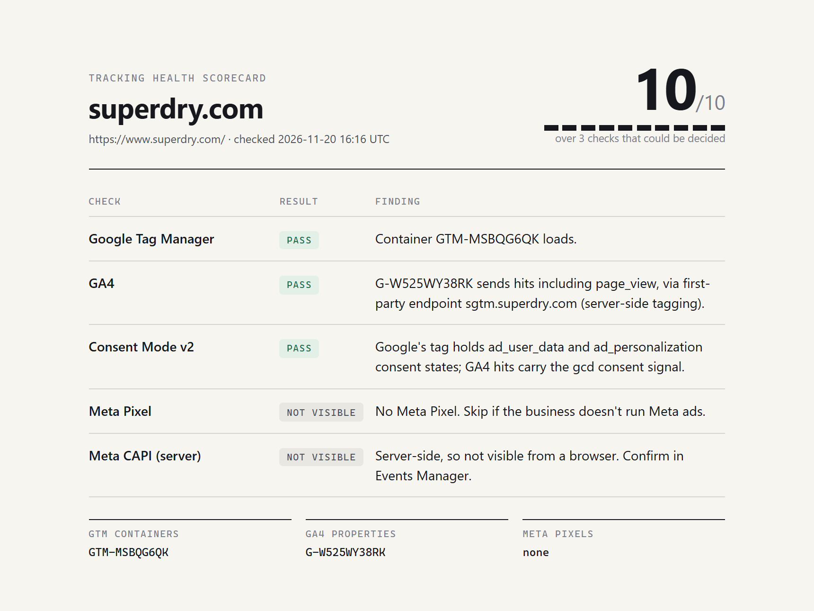
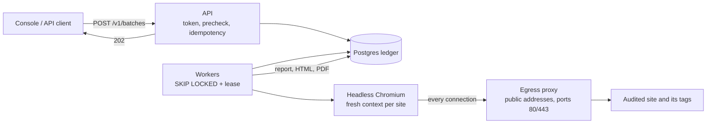

# tracking-audit

[](https://github.com/Idris-Michael/tracking-audit/actions/workflows/ci.yml)

A pre-sales tracking audit. One clean page load in a headless browser, before any cookie banner is
touched, then a scorecard for Google Tag Manager, GA4 (including server-side endpoints), Consent Mode
v2, the Meta Pixel and Pixel/CAPI deduplication. CLI, batch mode, an API with queued workers, and HTML
and PDF scorecards a prospect can receive. Every browser connection goes through an egress proxy, so
the auditor cannot be steered at private addresses, redirects included.



<sub>A live run in real time (48 s) against real UK retail sites, with the API, worker and Postgres in Docker.</sub>

> Framed as a pilot for a **fictional** UK agency, Fieldnote Digital ([brief](docs/engagement/brief.md)).
> The code, tests and measurements are real.

## Results

Raw figures in [`bench/results.json`](bench/results.json); the 20 sites were fixed and committed
before the first run ([`bench/sites.txt`](bench/sites.txt)).

| | Result | Evidence |
|---|---|---|
| 20 UK retail homepages | **8 audited; 12 refused an automated browser** (11 with HTTP 403, 1 dropped the connection) | Measured locally |
| Time | Median **4.45 s** per audited site; all 20 in 18 s, four at a time | Measured locally |
| Verdicts against raw network captures, all 8 audited sites | Run 1: wrong on 3, misleading on 1. Run 2, after two fixes: **agrees on 8 of 8** | [Hand-checked against HAR files](bench/hand_check.md) |
| Private targets, redirects into localhost, LAN images, names resolving to private addresses | Refused or blocked | Tested with fixtures |
| Meta Pixel checks on real sites | Not exercised: no audited site fired a Pixel event before consent | Tested with fixtures only |
| Azure / AWS deployment | Terraform validated; tflint and checkov clean | Validated offline, not deployed |

The refusals are the sites' bot protection: for the two checked that way, a plain Playwright load
without this tool was refused the same way. The auditor does not disguise itself to get past them
([ADR 6](docs/adr/0006-do-not-disguise-the-browser.md)); for client work the answer is an allow-list
entry for its egress IP.



## How it works



- **One clean load, facts only.** No cookies, no clicks, nothing submitted. Results are pass, warning,
  fail or "not visible"; the score is over the checks that could be decided, and the card says what
  one load cannot show ([ADR 2](docs/adr/0002-one-clean-load-facts-only.md)).
- **SSRF is enforced at the network edge of the browser.** A local proxy applies the guard to every
  connection and connects to the address it checked, which also covers redirects and DNS rebinding
  ([ADR 3](docs/adr/0003-ssrf-guard-and-egress-proxy.md)).
- **The API never waits on a browser.** Audits are queued with an Idempotency-Key and claimed by
  workers with `FOR UPDATE SKIP LOCKED`; a site that cannot be audited is a finished result with its
  reason ([ADR 4](docs/adr/0004-queue-and-leased-workers.md)).
- **What a prospect receives cannot run anything.** Page text is escaped, scorecards are served with
  a no-script CSP, the console shows them in a sandboxed frame, and PDFs render offline.

## What broke while building it

- **Redirects walked straight past the SSRF check.** The original code checked URLs in Playwright's
  route handler, which only sees a request's first URL. In the first test, a redirect to
  `127.0.0.1:8080` reached a real service on the test machine. The rule now lives in an egress proxy
  every browser connection must use.
- **Server-side GA4 was invisible.** The hand check found GA4 hits going to `sgtm.superdry.com`,
  `sstc.dunelm.com` and `sgtm.hobbycraft.co.uk`. The tool only knew Google's hostnames, so it failed
  one site, warned on another and missed a second property on the third. A GA4 hit is now any
  `/g/collect` request with a `G-` ID, on any host ([ADR 5](docs/adr/0005-what-counts-as-ga4.md)).
- **The first batch of 20 never finished.** Since Python 3.12 a server's `wait_closed` waits for open
  connections, and Chromium keeps proxy tunnels open. The proxy now closes its own tunnels, and each
  audit has a 90-second cap.
- **"GA4" came out as "ga4".** `str.capitalize()` lower-cases everything after the first letter; the
  findings now keep their capitals, with a test.

## Run it

```bash
cp .env.example .env              # set API_TOKEN (24+ characters)
docker compose up -d --build      # Postgres, migrations, API, worker, Jaeger
open http://localhost:8080        # Audit Desk console; traces at http://localhost:16686
```

Or from the command line, no Docker:

```bash
uv sync && uv run playwright install chromium
uv run tracking-audit shop.example --html card.html --pdf card.pdf
uv run tracking-audit batch bench/sites.txt --out audits/
uv run pytest                     # 74 tests, 80% coverage gate; Postgres tests need Docker
```

Everything else is in the [runbook](docs/engagement/runbook.md).

## Repository map

```
src/tracking_audit/   analyse (the checks), capture (browser), guard + proxy (SSRF), report (cards),
                      audit (single and batch), cli, api, worker, db (ledger), static/console.html
bench/                sites.txt (20, fixed before the first run), results.json, hand_check.md
migrations/           Alembic
infra/                Terraform: Azure Container Apps, AWS ECS Fargate
docs/                 engagement brief, security questionnaire, runbook, handover, ADRs
```

## Evidence labels
**Measured locally**: run on a Windows laptop against the live sites on 20 November 2026.
**Hand-checked against HAR files**: a separate capture with plain Playwright and none of this code,
read request by request. **Tested with fixtures**: an in-memory shop served to the real browser.
**Validated offline**: Terraform checked, never applied.

## Licence
MIT
